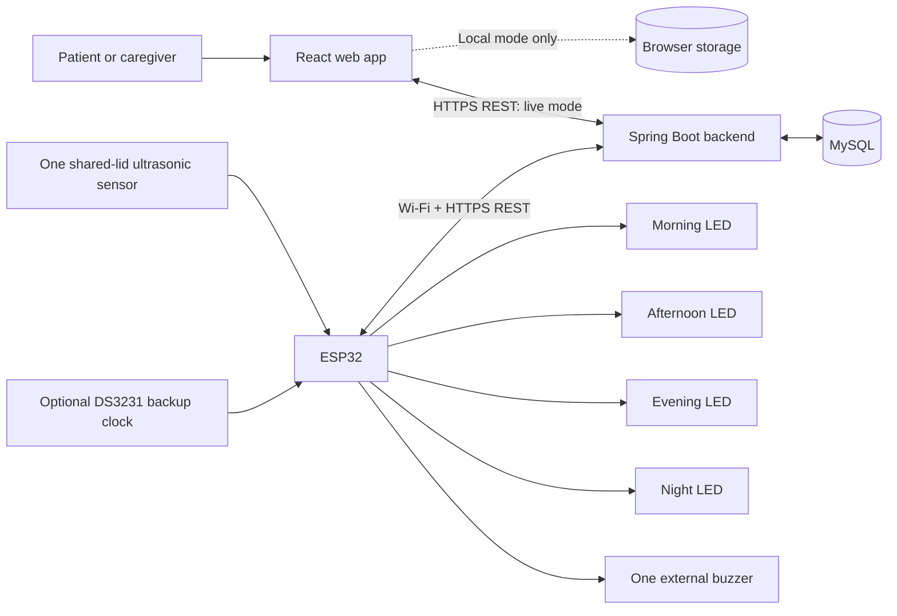

# 4. System architecture

## 1. What SmartMed does

SmartMed helps a patient follow a prescribed daily medicine routine. A caregiver fills four labelled sections—Morning, Afternoon, Evening, Night—inside one box with **one shared lid**. Several medicines can belong to the same section.

At each scheduled time, the matching LED blinks and one external buzzer sounds. The web app shows medicine names, strengths, quantities, and instructions. One ultrasonic sensor detects the shared lid opening and closing.

**A box opening is an access record.** It cannot prove which section was used, which medicine was selected, how many pills were removed, or whether medicine was swallowed. The software does not prescribe or recommend medicines. Refilling is manual and daily.

## 2. Current implementation versus planned system

| Component | Current status |
| --- | --- |
| React/Vite frontend | Implemented: Today, Schedule, History |
| Local schedule storage | Implemented: user-entered records in the current browser only |
| Live API adapter | Implemented connection hooks; requires the backend described in the integration guide |
| Spring Boot backend and MySQL | Planned; not included in this repository |
| Authentication and shared patient access | Planned; not included |
| ESP32 firmware and physical hardware | Planned; wiring is a proposed build, not physically verified |
| Local hardware reminders and event uploads | Require the backend, firmware, and hardware implementation |
| SMS/email alerts | Optional future work; not implemented or needed for the first end-to-end version |

The frontend starts empty. It does not insert sample patients, sample prescriptions, sensor readings, or opening events. Local mode cannot create physical box history or operate a buzzer. A successful frontend build does not mean the complete connected system is deployed.

## 3. Architecture diagram

The diagram below is the intended connected deployment. The browser-local path works today; the backend/device path still needs implementation.

The browser calls the backend, not the ESP32. The ESP32 initiates outbound requests, so it does not need a public IP address or an exposed inbound port. Neither the browser nor firmware connects directly to MySQL. MQTT is unnecessary for the initial version.

## 4. Responsibilities

| Layer | Responsibility |
| --- | --- |
| Patient/caregiver | Enter the prescription accurately, load/refill labelled sections, follow the displayed list |
| Web app | Display Today, edit schedules, show received box history; keep diagnostics out of patient screens |
| Backend | Authenticate users/devices, authorize access, validate writes, generate dated reminders, store/deduplicate events, provide history |
| Database | Preserve schedules, historical reminder instances, physical events, device bindings, and audit information |
| ESP32 | Keep time, cache reminders, read the lid sensor, drive LEDs/buzzer, persist and upload events |
| Sensor | Supply measurements for calibrated whole-lid state detection; not identify medicine selection |

## 5. Data flow

### A. Saving a schedule

1. Caregiver adds a prescribed medicine to a daily section and chooses its reminder time.
2. In local mode, the app saves it only in that browser.
3. In live mode, the backend atomically saves the medicine and the section's shared reminder time in MySQL.
4. Backend generates dated reminder instances with stable IDs and UTC timestamps.
5. ESP32 downloads a versioned upcoming-reminder snapshot and saves it persistently.

Changing a section's time affects all medicines in that section. Multiple medicines in one section do not require separate LEDs or separate sensor channels.

### B. Reminder and physical access

1. At reminder time, ESP32 blinks the appropriate section LED and sounds the shared buzzer.
2. Patient reads the scheduled list and follows the matching compartment label.
3. A stable sensor CLOSED → OPEN transition creates a `BOX_OPENED` event; a stable close creates `BOX_CLOSED`.
4. Firmware saves each event durably and uploads it to the backend.
5. Backend validates device identity, commits each unique event once, and acknowledges it.
6. Backend may attach reminder timing context; it does not claim the listed medicines were taken.
7. The web app's next refresh shows the received history. Live refresh runs every 10 seconds.

Opening outside a reminder window remains an ordinary box event. A lid already open at startup is a state report, not proof of a new opening.

## 6. Minimal backend data model

These are proposed server-side entities, not database tables already present in this frontend repository.

| Entity | Key information |
| --- | --- |
| User and care assignment | Authenticated identity and authorized patient/workspace |
| Daily slot | Patient/workspace, one of four fixed slot IDs, configured local time or null |
| Medicine entry | Slot, name, strength, quantity, instructions; entered from prescription |
| Reminder instance | Stable ID, slot, schedule version, UTC scheduled/window-end timestamps |
| Device | Assigned workspace, credential binding, last heartbeat, configuration/schedule versions |
| Box event | Unique device/event identity, OPENED/CLOSED type, occurrence/receipt timestamps, sequence, optional immutable reminder context |

Keep recurring schedules separate from dated access records. Yesterday's event must not mark today's reminder as accessed. Preserve historical context after a medicine is edited or removed. Enforce a unique `(device_id, event_id)` constraint to make upload retries safe.

## 7. Connectivity, timing, and failure behavior

- Use the patient's actual IANA timezone for the live schedule, UTC timestamps in storage/transmission, and the browser timezone for local-only schedules.
- ESP32 reminders run from a persisted schedule and valid clock, even when Wi-Fi is unavailable. The optional RTC preserves time, not power to the whole box.
- Queue events across restarts; delete them only after backend acknowledgment. Retry failed uploads with backoff.
- Missing echoes are invalid sensor readings unless a reliable detection method establishes otherwise. Report monitoring gaps instead of inventing openings.
- A heartbeat does not prove a past offline period had no openings. Any future missed-opening logic needs reconciled event coverage; the current UI makes no missed-dose or intake conclusions.
- Expired schedules, invalid clocks, or sensor faults must remain visible to system operators. Do not silently fabricate successful monitoring.
- Live API errors preserve the last received view with an error, or an unavailable state on first load. They never fall back to synthetic records.
- Local and live storage are separate. There is no implemented automatic migration from local browser schedules to the backend.

## 8. Deployment boundary

For a real deployment, serve the frontend and API through HTTPS, preferably on the same origin. Complete caregiver authentication, patient authorization, CSRF/session handling, device provisioning, TLS certificate validation, and database persistence before use with real patient information.

Device credentials belong in controlled firmware/backend provisioning, never in browser variables, Git, or URLs. The web app should continue to expose only routine management and box history; calibration and firmware diagnostics belong in protected operator tooling.

## 9. Build order

1. Verify one physical lid sensor can distinguish closed/open states in the actual enclosure.
2. Implement backend event ingestion and history storage.
3. Complete **physical lid opening → committed backend event → web history**.
4. Connect schedule editing, dated reminders, the four LEDs, and the shared buzzer.
5. Verify offline operation, event retries, restarts, and schedule updates.
6. Complete authentication, authorization, and secure deployment.

Detailed steps are in [Microcontroller integration](02_MICROCONTROLLER_INTEGRATION.md), physical connections in [Hardware connections](03_HARDWARE_CONNECTIONS.md), and laptop commands in [Run the application](01_RUN_APPLICATION.md).
